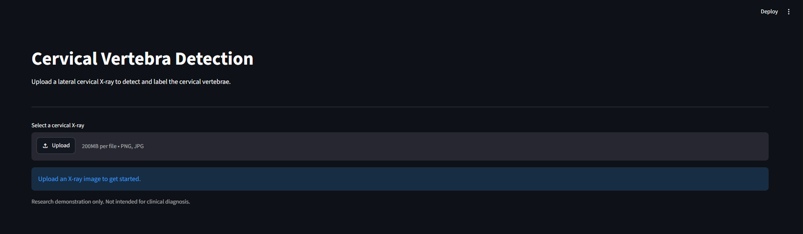
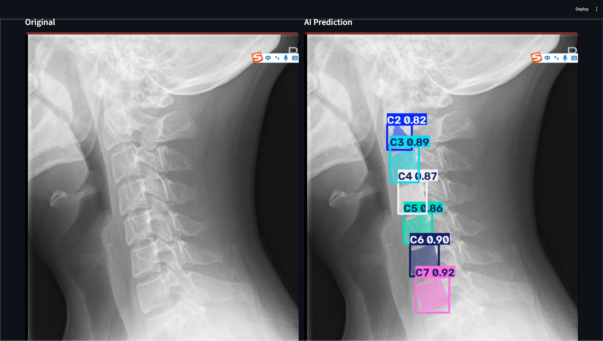
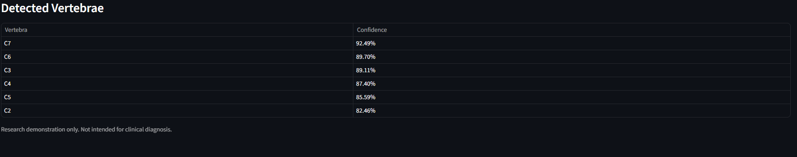

# Cervical Spine X-ray Vertebra Labeling

**AI-assisted cervical vertebra detection and labeling from lateral cervical spine X-rays using YOLO instance segmentation and Streamlit.**

This project is a lightweight proof of concept demonstrating how deep learning and computer vision can be used to automatically identify and label cervical vertebral bodies in radiographic images.

The application allows users to upload an X-ray image, run inference using a trained YOLO segmentation model, and visualize the predicted vertebral labels directly on the image.

> **Disclaimer:** This project is intended for research, educational, and demonstration purposes only. It is not a medical device and must not be used for clinical diagnosis, treatment planning, or medical decision-making. Predictions require review by a qualified medical professional.

---

## Demo

## Application Interface




## Vertebra Detection Result

## Prediction Results


---

## Features

- Upload cervical spine X-ray images through a simple web interface.
- Automatically detect and label cervical vertebral bodies.
- Identify vertebral levels from C2 to C7.
- Generate segmentation overlays on the original radiograph.
- Display confidence scores for detected vertebrae.
- Visualize original and annotated images side by side.
- Train a custom YOLO segmentation model using the CSXA dataset.
- Easily extend the application with additional image-processing techniques and measurements.

---

## Technology Stack

| Component | Technology |
|---|---|
| Programming language | Python |
| Deep learning | PyTorch |
| Object detection and segmentation | Ultralytics YOLO |
| Image processing | OpenCV |
| Visualization | Streamlit |
| Dataset | CSXA Cervical Spine X-ray Atlas |

---

## Methodology

The project follows a simple computer vision pipeline:

```text
Lateral Cervical X-ray
        |
        v
Image Preprocessing
        |
        v
YOLO Instance Segmentation
        |
        v
Vertebral Body Detection
        |
        v
Cervical Level Classification
        |
        v
Segmentation Visualization
        |
        v
Annotated X-ray
```

The model is trained to identify six vertebral classes:

| Class ID | Vertebral Level |
|---|---|
| 0 | C2 |
| 1 | C3 |
| 2 | C4 |
| 3 | C5 |
| 4 | C6 |
| 5 | C7 |

The segmentation targets are derived from the anatomical landmarks provided by the CSXA dataset.

**Note:** The generated polygons represent vertebral-body geometry derived from landmarks, rather than complete pixel-wise anatomical segmentation of all vertebral structures.

---

## Dataset

This project uses the **Cervical Spine X-ray Atlas (CSXA)** dataset.

- Dataset: [CSXA — Science Data Bank](https://doi.org/10.57760/sciencedb.15391)
- Dataset publication: [CSXA research paper](https://pmc.ncbi.nlm.nih.gov/articles/PMC11176335/)

The dataset provides lateral cervical spine radiographs and associated anatomical annotations.

### Dataset Preparation

Download the dataset from its official source and extract the images and JSON annotations.

The expected directory structure is:

```text
data/
└── raw/
    ├── images/
    │   ├── image_001.png
    │   ├── image_002.png
    │   └── ...
    │
    └── json/
        ├── image_001.json
        ├── image_002.json
        └── ...
```

Each image must have a corresponding JSON annotation file with the same filename stem.

**Important:** The dataset is not included in this repository. Users must download it separately and comply with the dataset's applicable terms and licensing conditions.

---

## Repository Structure

```text
cervical-spine-xray-labeling/
│
├── app.py
├── train.py
├── predict.py
├── inspect_json.py
├── visualize_raw.py
├── convert_dataset.py
├── verify_dataset.py
├── data.yaml
├── requirements.txt
│
├── data/
│   ├── raw/
│   │   ├── images/
│   │   └── json/
│   │
│   └── yolo/
│       ├── images/
│       │   ├── train/
│       │   └── val/
│       │
│       └── labels/
│           ├── train/
│           └── val/
│
├── models/
│
├── runs/
│
└── docs/
    └── images/
```

Dataset files, trained model weights, and generated training outputs are excluded from version control by default.

---

## Installation

### 1. Clone the repository

```bash
git clone https://github.com/YOUR_USERNAME/cervical-spine-xray-labeling.git

cd cervical-spine-xray-labeling
```

Replace `YOUR_USERNAME` with your GitHub username.

### 2. Create a Python environment

Using Conda:

```bash
conda create -n cervical python=3.10 -y

conda activate cervical
```

Alternatively, use Python's built-in virtual environment:

```bash
python -m venv .venv
```

Activate it on Windows:

```powershell
.venv\Scripts\activate
```

### 3. Install dependencies

```bash
pip install -r requirements.txt
```

For GPU training, install the appropriate PyTorch version for your CUDA configuration:


Verify CUDA availability:

```python
import torch

print("CUDA available:", torch.cuda.is_available())

if torch.cuda.is_available():
    print(torch.cuda.get_device_name(0))
```

---

## Dataset Preparation

### 1. Inspect the annotations

```bash
python inspect_json.py
```

This script examines the dataset JSON files and reports annotation labels.

### 2. Visualize the original annotations

```bash
python visualize_raw.py
```

This step is useful for checking that the anatomical landmarks correctly align with the radiographs.

### 3. Convert the dataset

```bash
python convert_dataset.py
```

The conversion pipeline:

- Matches images with their JSON annotations.
- Extracts the vertebral landmarks.
- Converts anatomical landmarks into polygon annotations.
- Normalizes polygon coordinates.
- Converts the annotations into YOLO segmentation format.
- Splits the dataset into training and validation subsets.

The current configuration uses an 80/20 training-validation split.

### 4. Verify the converted dataset

```bash
python verify_dataset.py
```

Visually inspect the generated polygons before training.

Incorrect polygon geometry or vertebral labeling can significantly affect model performance.

---

## Model Training

The model is trained using Ultralytics YOLO instance segmentation.

### Training Configuration

The training configuration can be modified in `train.py`.

Typical parameters include:

| Parameter | Description |
|---|---|
| `epochs` | Number of training epochs |
| `imgsz` | Input image resolution |
| `batch` | Batch size |
| `device` | GPU or CPU |
| `workers` | Data-loading workers |

### Start Training

```bash
python train.py
```

For the initial configuration, a lightweight YOLO segmentation model is used.

After training, the best model weights are typically saved at:

```text
runs/cervical_segmentation/weights/best.pt
```

Update the model path in `app.py` if your training configuration saves the weights elsewhere.

---

## Running the Application

The application uses Streamlit to provide a simple web interface.

### Start the application

```bash
streamlit run app.py
```

Open the following address in your browser:

```text
http://localhost:8501
```

### Application Workflow

1. Open the web application.
2. Upload a cervical spine X-ray.
3. Click **Run Vertebra Detection**.
4. Wait for the model to complete inference.
5. View the original image and annotated prediction side by side.
6. Review the detected vertebral levels and confidence scores.


## Limitations

This project is an early-stage MVP and has several limitations:

- The model is trained primarily on lateral cervical spine radiographs.
- C1 is not included in the current classification pipeline.
- The segmentation polygons are derived from anatomical landmarks.
- Vertebral labeling may be incorrect in cases of poor image quality, abnormal anatomy, or incomplete visualization.
- Confidence scores are model outputs and should not be interpreted as clinical certainty.
- The current application does not perform clinical validation.
- The model may not generalize to different imaging protocols, institutions, or patient populations.

Further development may include anatomical consistency checks, improved landmark detection, additional vertebral levels, image enhancement, and quantitative cervical alignment measurements.

---

## Future Work

Potential extensions include:

- C1 vertebra detection and labeling.
- Anatomically constrained vertebral ordering.
- Manual correction of predicted vertebral labels.
- Improved landmark detection.
- Cervical alignment measurements.
- C2–C7 Cobb angle estimation.
- C2–C7 sagittal vertical axis measurement.
- Additional image enhancement techniques.
- Export of annotations to JSON, PNG, and PDF.
- Model evaluation across different imaging institutions.

---

## References

1. Cervical Spine X-ray Atlas (CSXA). [Dataset](https://doi.org/10.57760/sciencedb.15391).
2. CSXA Dataset Publication. [Research article](https://pmc.ncbi.nlm.nih.gov/articles/PMC11176335/).
3. Ultralytics YOLO. [Documentation](https://docs.ultralytics.com/).
4. Streamlit. [Documentation](https://docs.streamlit.io/).

---

## License
This project is licensed under the MIT License. See the [LICENSE](LICENSE)
file for details.

The license for this repository applies to the original project code only. Dataset files, pretrained weights, and third-party components may be subject to separate licensing terms.


